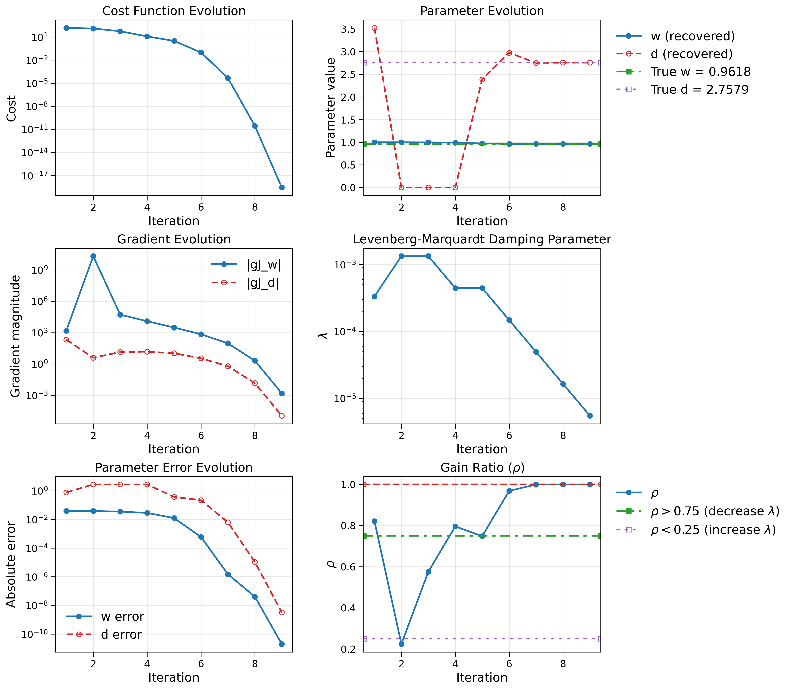
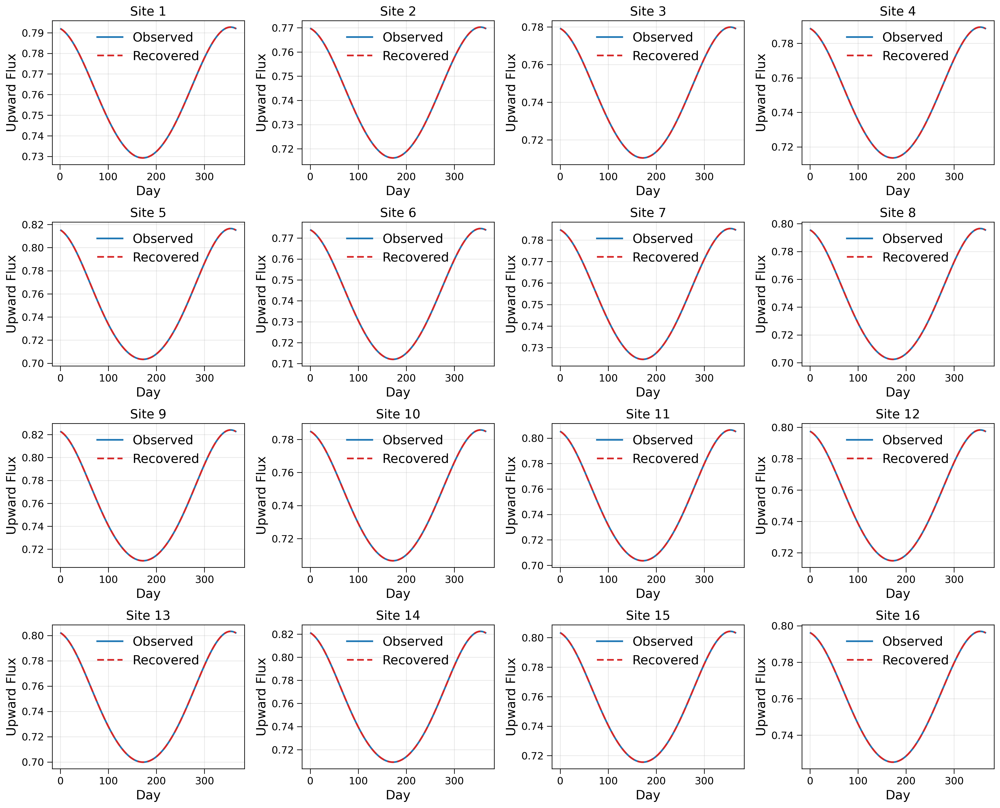

# Calibration of w and d using the JAX forward model

This example is the JAX version of the Fortran forward (tangent) calibration. It recovers two parameters shared by all sites in the two-stream radiation transfer solver:

- `w`: single-scattering albedo
- `d`: preferred directional scattering parameter

The overall problem, the objective function, the Gauss-Newton Hessian, the Levenberg-Marquardt (LM) algorithm, the convergence criteria and the identifiability diagnostic are the same as in the Fortran example, so they are not repeated here. Only what is specific to the JAX implementation is described below.

## How it differs from the Fortran version

| | Fortran | JAX |
|---|---|---|
| Derivatives | Tapenade tangent (`multilevel_matrix_d`), two calls per (site, day) | `jax.jacfwd` (forward-mode autodiff) |
| Loop over sites and days | explicit double loop | `jax.vmap` over all observations |
| Build | `make` | none, run the Python script |

The optimizer itself is unchanged: same initial guess (`w = d = 0.5`), same bounds, same explicit 2x2 solve for the damped Gauss-Newton step, same backtracking line search, same `rho`-based update of `lambda`, and same tolerances.

## How the Jacobian is built

1. `fup_top(w, d, mu, rs, t)` computes the upward flux at the top level for one (site, day).
2. `jax.vmap` evaluates it for all `n_sites * 365` observations at once. `w` and `d` are shared, while `mu`, `rs` and `t` vary per observation.
3. `jax.jacfwd` differentiates this batched function with respect to `p = [w, d]` and returns the full `(N, 2)` Jacobian in one call. This replaces the two tangent calls per (site, day) in the Fortran code.

Observations are flattened site by site (site 1 days 1 to 365, then site 2, and so on). The per-site values `rs` and `t` are repeated for each day so that all inputs have the same length.

## Requirements

- Python 3
- `jax`
- `equinox`
- `numpy`

The JAX forward model must be importable. Edit this line in `calibrate.py` to match your model file:

```python
from global_module_multilevel_matrix_d import Global_module_multilevel_matrix_eqx
```

`nlevels_tot` is set to `nl + 1` as a plain Python integer (needed so that array shapes stay static under `jit`), and 64-bit precision is enabled with `jax_enable_x64`.

## Run

```bash
python calibrate.py --n_sites 8
```

Options:

- `--n_sites`: number of sites (default 8)
- `--seed`: random seed, to reproduce the same synthetic problem (default: random)

The program generates a new synthetic calibration problem at each execution, then tries to recover the true `w` and `d`.

## Output files

| File | Content |
|---|---|
| `true_parameters.txt` | true `w` and `d` |
| `optimization_history.txt` | columns: `iter cost w d gJ_w gJ_d lambda rho` |
| `fluxes_comparison.txt` | columns: `site day fup_model fup_obs` |

These have the same format as the Fortran output, so the same plotting script can be used:

```bash
python ~/Fgpt/examples/autodiff/Fortran/forward/plots.py --n_sites 8
```
The optimization procedure generates two diagnostic figures:

- `optimization_history.png`: Summarizes the optimization process, including the cost function, parameter evolution, gradient evolution, Levenberg–Marquardt damping parameter (λ), parameter errors, and gain ratio (ρ).

- `flux_comparison.png`: Compares the reference and recovered upward fluxes over the full year (365 days) for each site, illustrating how well the optimized parameters reproduce the reference fluxes.

The resulting figures are shown below.

<p align="center">
  
</p>

<p align="center">
  
</p>

## Notes

- The random numbers differ from the Fortran ones, so a Python run and a Fortran run are not on the same synthetic problem. To compare both models directly, run them on the same inputs.
- A successful run recovers `w` and `d` to about `1e-6` (the true-parameter recovery criterion).
