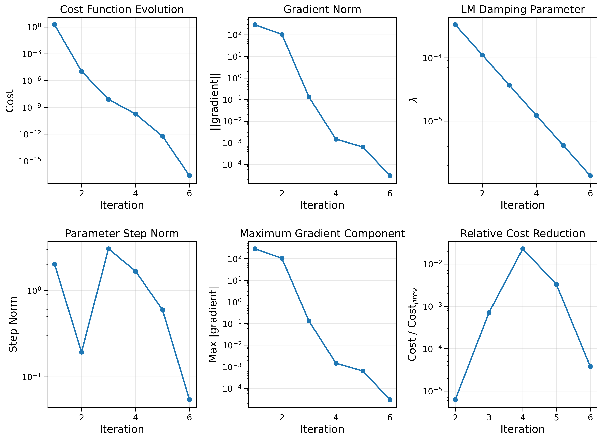
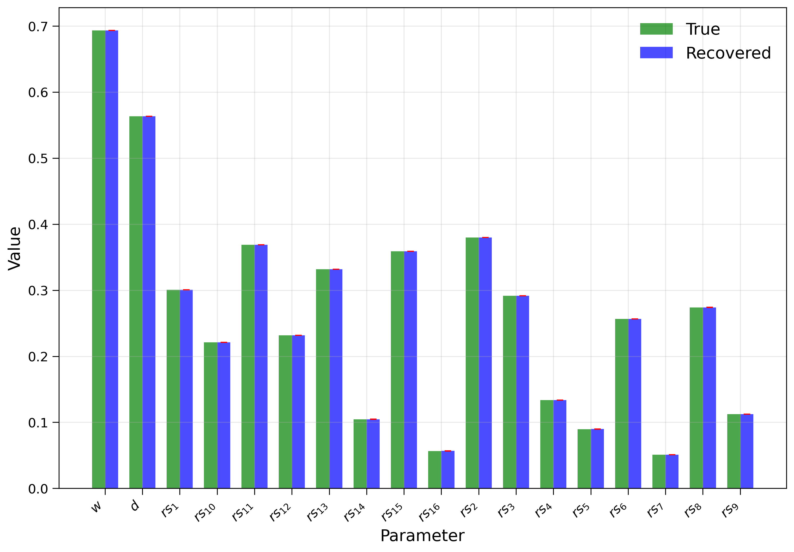
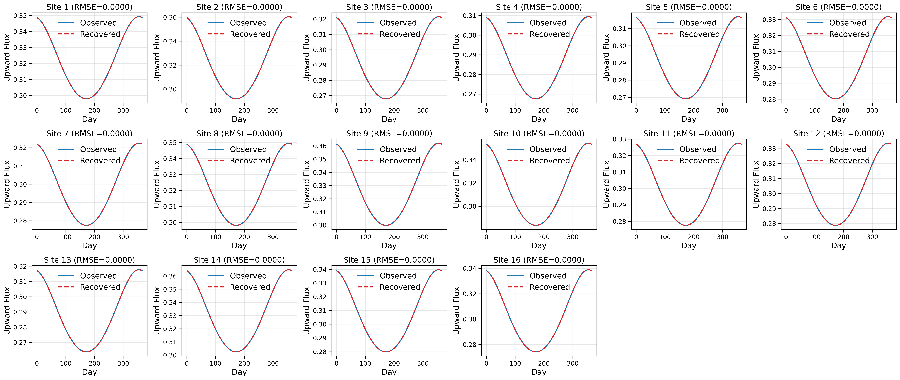

# Calibration of w, d and rs using the JAX reverse model

This example is the JAX version of the Fortran adjoint calibration. It recovers three kinds of parameters in the two-stream radiation transfer solver:

- `w`: single-scattering albedo (shared across sites)
- `d`: preferred directional scattering parameter (shared across sites)
- `rs`: surface reflectance (one value per site)

The overall problem, the objective function, the Gauss-Newton Hessian and the Levenberg-Marquardt (LM) algorithm are the same as in the Fortran example, so they are not repeated here. Only what is specific to the JAX implementation is described below.

## How it differs from the Fortran version

| | Fortran | JAX |
|---|---|---|
| Derivatives | Tapenade adjoint (`multilevel_matrix_b`) | `jax.grad` (reverse-mode autodiff) |
| Loop over sites and days | explicit double loop | `jax.vmap` over all observations |
| Linear solve | custom Gaussian elimination | `numpy.linalg.solve` |
| Build | `make` | none, run the Python script |

The optimizer itself is unchanged: the parameter vector is `p = [w, d, rs_1, ..., rs_N_sites]`, the damping is scaled per parameter, and the same bounds and convergence tests are used.

## How the Jacobian is built

1. `fup_top(w, d, rs, mu, t)` computes the upward flux at the top level for one (site, day).
2. `jax.vmap(jax.grad(fup_top, argnums=(0, 1, 2)))` returns the gradient with respect to `w`, `d` and `rs` for every observation at once. This replaces one adjoint call per (site, day) in the Fortran code.
3. Each gradient is placed in one row of the Jacobian, in columns `w`, `d` and the column of that observation's site `rs`. All other entries of the row are zero.

Observations are flattened site by site (site 1 days 1 to 365, then site 2, and so on). `site_idx` records which `rs` parameter each observation uses.

## Requirements

- Python 3
- `jax`
- `equinox`
- `numpy`

The JAX forward model must be importable. Edit this line in `calibrate.py` to match your model file:

```python
from global_module_multlevel_matrix import Global_module_multilevel_matrix_eqx
```

`nlevels_tot` is set to `nl + 1` as a plain Python integer (needed so that array shapes stay static under `jit`), and 64-bit precision is enabled with `jax_enable_x64`.

## Run

```bash
python calibrate.py --n_sites 8
```

Options:

- `--n_sites`: number of sites (default 8)
- `--seed`: random seed, to reproduce the same synthetic problem (default: random)

The program generates a new synthetic calibration problem at each execution, then tries to recover the true parameters starting from `w = d = rs = 0.5`.

## Output files

| File | Content |
|---|---|
| `w_d_rs_true.txt` | true `w`, `d` and `rs` of each site |
| `w_d_rs_optimization_history.txt` | columns: `iter cost grad_norm lambda_lm step_norm max_gradient` |
| `w_d_rs_recovered.txt` | recovered value, true value and absolute error for each parameter |
| `w_d_rs_flux_comparison.txt` | columns: `site day Fup_model Fup_obs residual` |

These have the same format as the Fortran output, so the same plotting script can be used:

```bash
python ~/Fgpt/examples/autodiff/Fortran/reverse/plots.py --n_sites 8
```
The resulting figures provide:

- Optimization convergence diagnostics.
- Comparison between true and recovered parameters.
- Comparison between observed and recovered upward fluxes over the annual cycle.

For a detailed description of each figure, see the ``Diagnostic Plots`` section of the Fortran section.

The resulting figures are shown below.

<p align="center">
  
</p>

<p align="center">
  
</p>

<p align="center">
  
</p>

## Notes

- If the run stops on the gradient tolerance, the last row of the history file is a bookkeeping entry: no step was taken, so `step_norm` is `0`. On a log axis it looks like the step norm drops to zero. This is not an optimizer failure.
- The random numbers differ from the Fortran ones, so a Python run and a Fortran run are not on the same synthetic problem. To compare both models directly, run them on the same inputs.
